# Relaxios

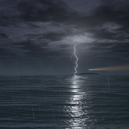

A silent iPhone app that plays slow, relaxing thunderstorms fullscreen, with no buttons and nothing on screen but the storm.

<p align="center">
  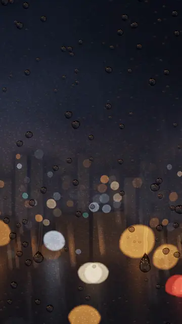
</p>

Every storm is drawn by a shader, rendered offline on a Mac and shipped as a seamless 40 second video loop. Nothing is filmed. Swipe to change the storm, turn the phone to see it in landscape, and leave it running.

## The storms

Swipe left for the next storm and right for the previous one. They come in this order, and the app remembers the last one you watched.

### 1. Rain on the Window

Rain beads and trickles down the glass in front of a blurred city at night, while lightning flickers behind the towers.

| Portrait, calm | Portrait, strike | Landscape, calm | Landscape, strike |
|:---:|:---:|:---:|:---:|
| 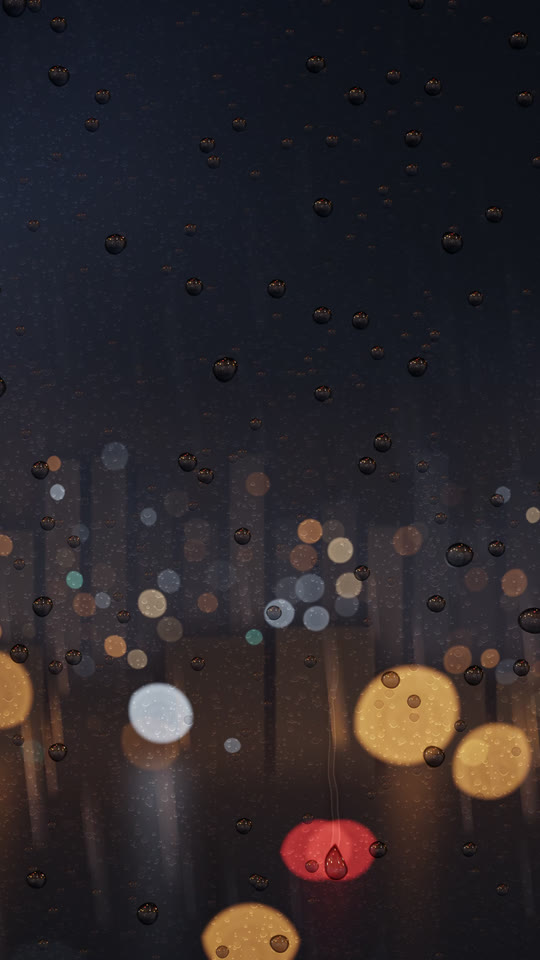 | 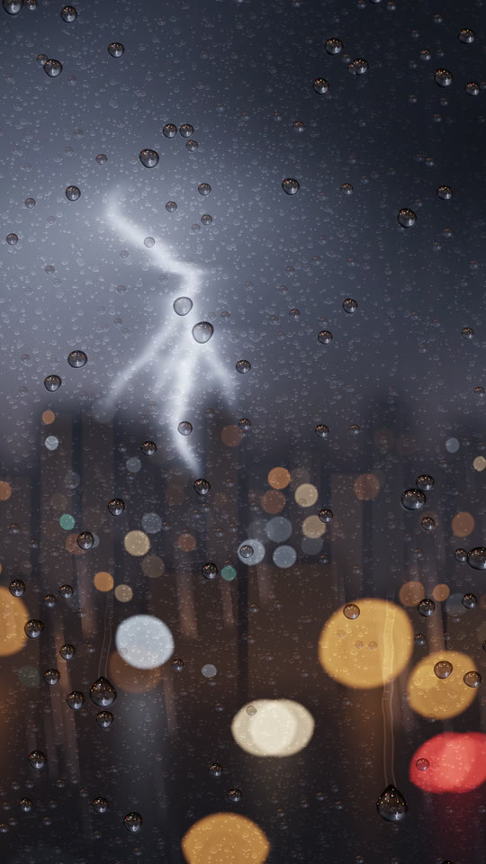 | 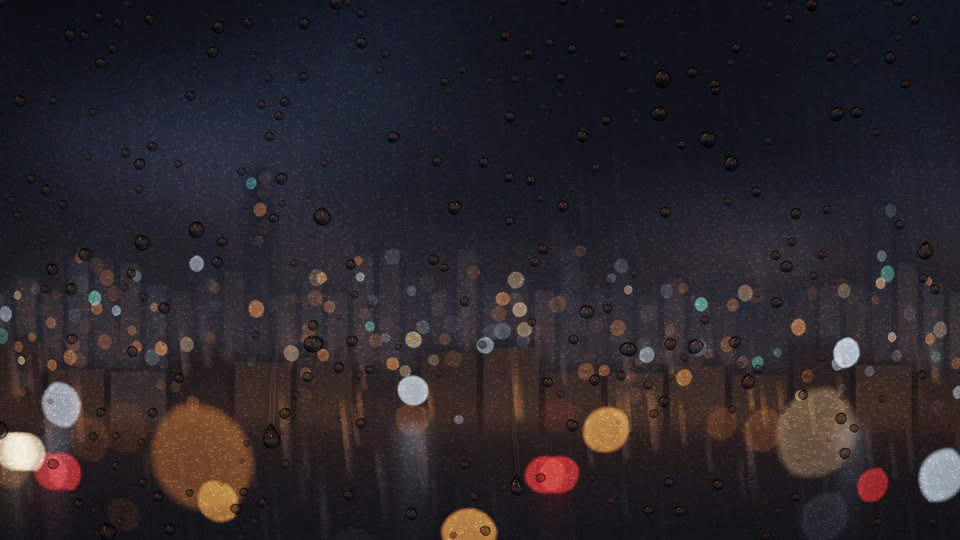 | 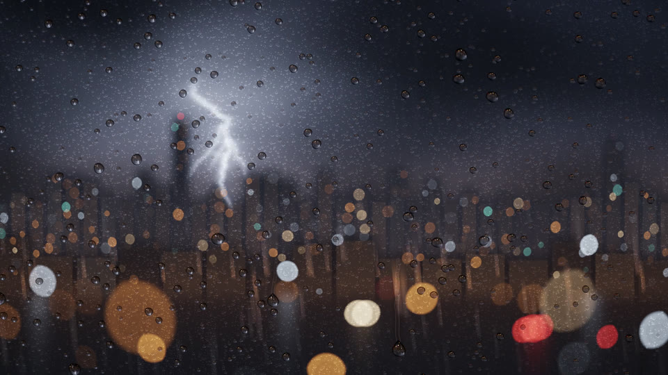 |

### 2. Distant Storm

A lone storm cloud towers over dark grassland far away, with small bolts dropping from its base.

| Portrait, calm | Portrait, strike | Landscape, calm | Landscape, strike |
|:---:|:---:|:---:|:---:|
| 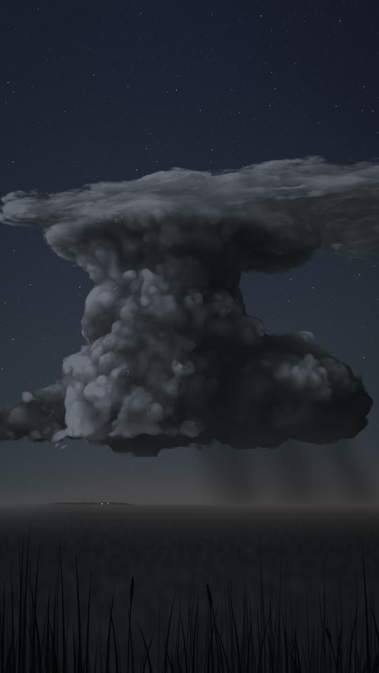 | 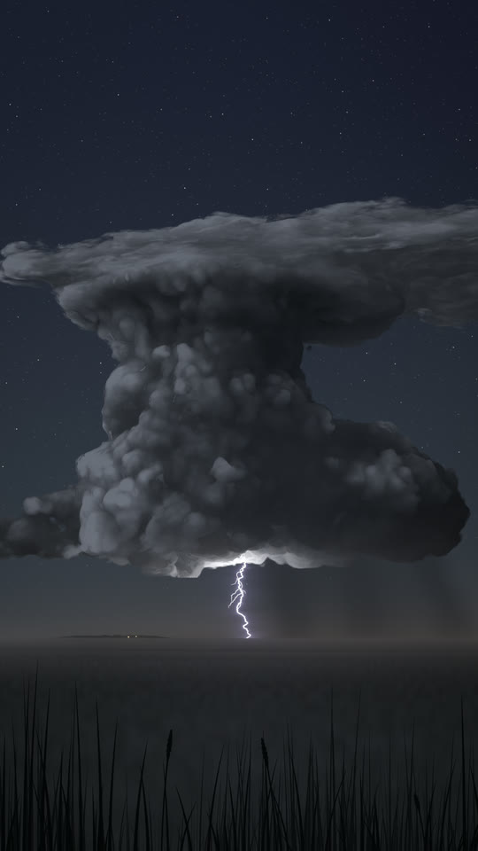 | 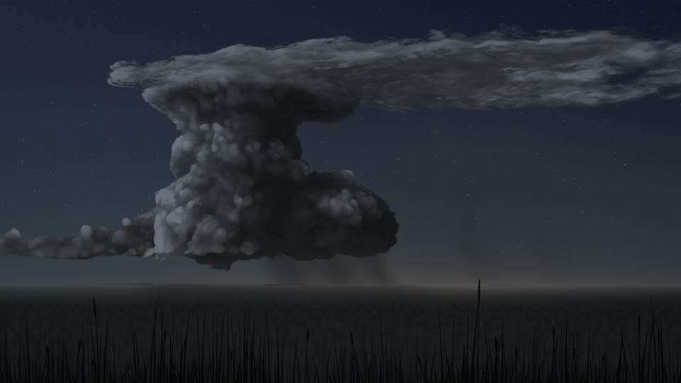 | 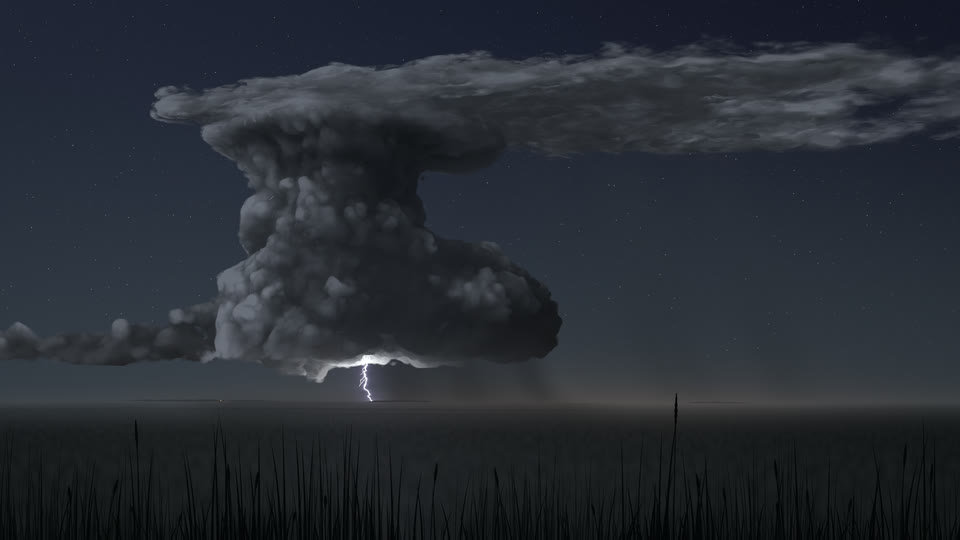 |

### 3. Storm at Sea

Rain falls on a rolling night sea, a lighthouse beam sweeps from a small island, and each strike is mirrored in the water.

| Portrait, calm | Portrait, strike | Landscape, calm | Landscape, strike |
|:---:|:---:|:---:|:---:|
| 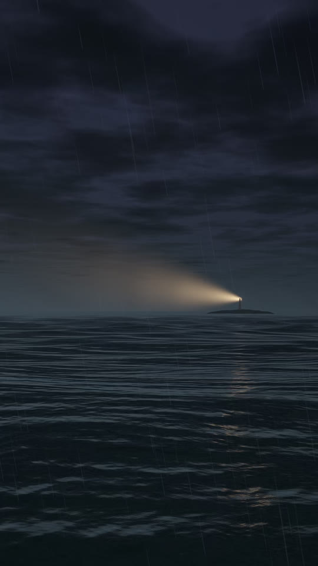 | 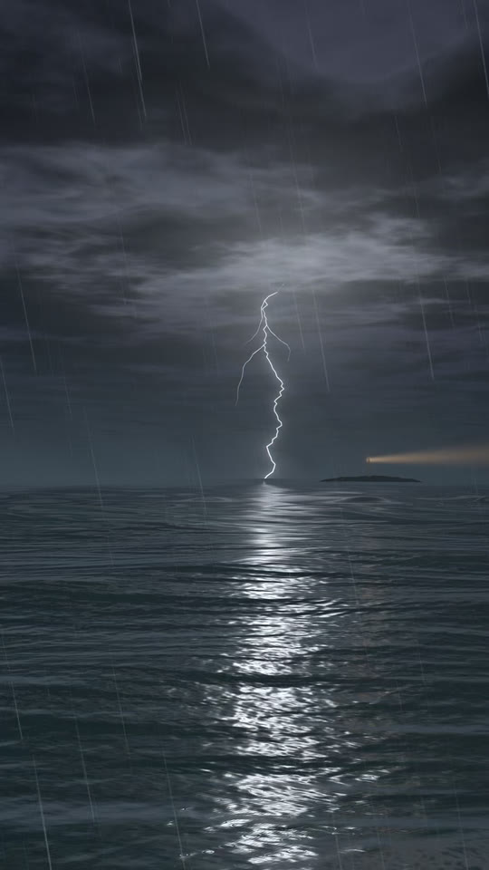 | 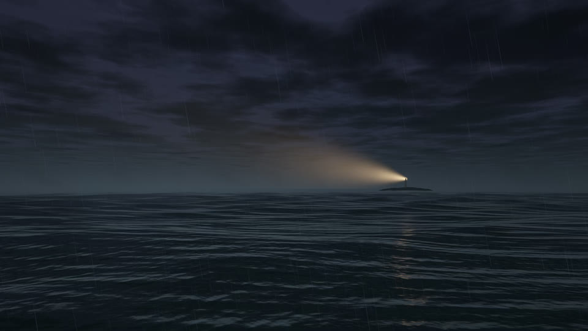 | 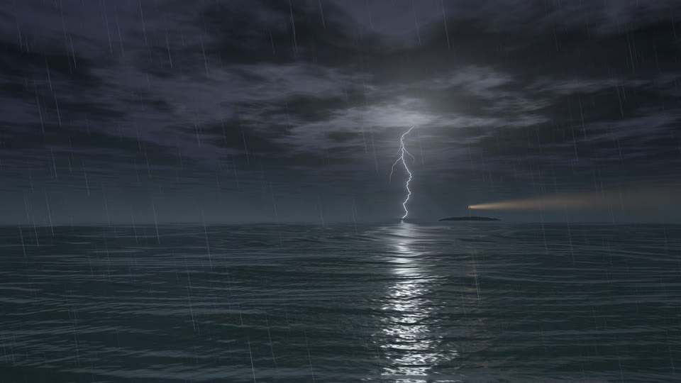 |

### 4. Above the Storm

You float above the cloud deck under the stars, and the storm towers glow from inside when lightning fires.

| Portrait, calm | Portrait, strike | Landscape, calm | Landscape, strike |
|:---:|:---:|:---:|:---:|
| 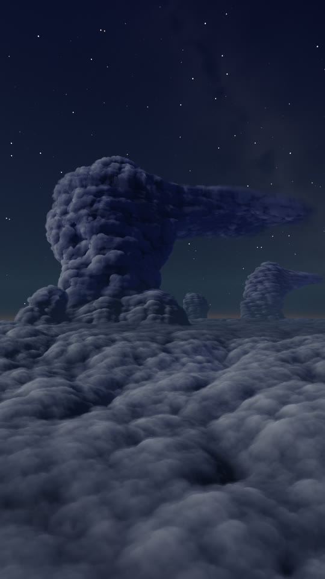 | 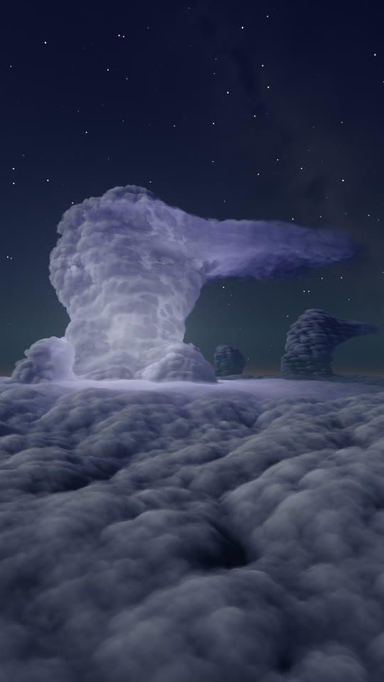 | 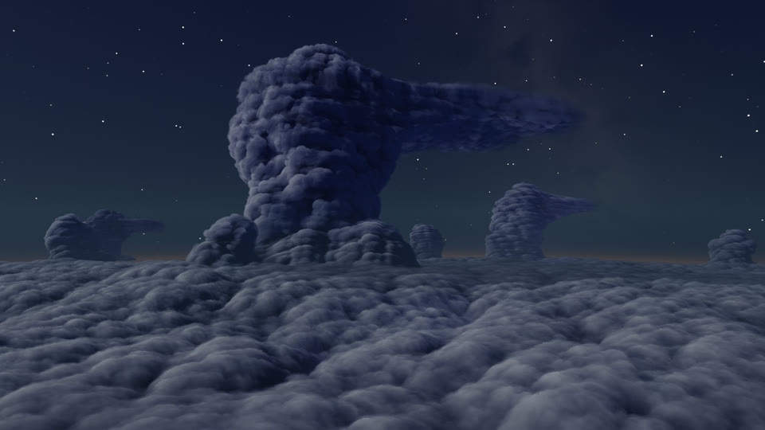 | 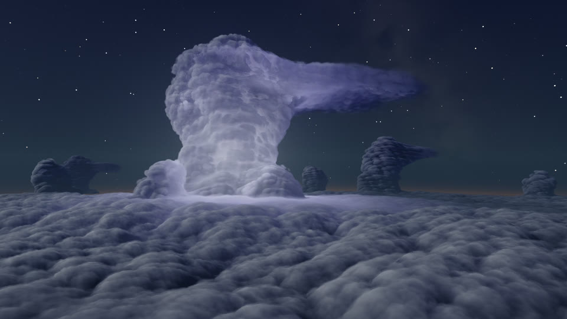 |

All of these are single frames taken straight from the videos that ship in the app.

## Features

- **Zero UI.** No buttons, menus or status bar, and the home indicator fades away. Just the storm.
- **Seamless 40 second loops.** The last frame flows into the first, so there is no visible jump when the loop restarts.
- **Portrait and landscape**, each composed for its shape rather than cropped, at 720p and 1080p. The app picks 1080p on larger screens and 720p on smaller ones or in Low Power Mode.
- **10-bit HEVC.** Dark night skies are full of soft gradients, and 10-bit video keeps them smooth instead of banded.
- **Rotation keeps the same moment.** When you turn the phone the app crossfades to the other orientation at the same point in the loop, so a strike in progress carries on.
- **Mixes with your music.** The videos are silent and the app never interrupts whatever audio, podcast or rain sounds you are already playing.
- **Keeps the screen awake** while it is open, and lets it sleep normally once you leave.
- **Soft, photosensitivity-safe lightning.** Strikes are mostly in-cloud glows and distant bolts that brighten over a frame or two and fade over about a second. Every video is checked so the frame brightness never makes more than 3 large flashes in any 1 second window.

## Gestures

| Gesture | What it does |
|---|---|
| Swipe left | Next storm |
| Swipe right | Previous storm |
| Rotate the phone | Same storm, framed for the new orientation, at the same moment |

That is all of them.

## Install it on your iPhone

You need a Mac with Xcode and an iPhone on iOS 16 or later. The app is not on the App Store.

1. Clone this repo and open `Relaxios.xcodeproj` in Xcode.
2. Select the **Relaxios** target, open **Signing & Capabilities**, and choose your **Team** (sign in with your Apple ID under Xcode > Settings > Accounts if it is not listed). If Xcode says the bundle identifier is unavailable, change `dev.vaibhavkumar.relaxios` to something unique, such as `com.yourname.relaxios`.
3. Plug in your iPhone (or pair it over Wi-Fi), pick it as the run destination, and press **Run**.
4. The first time, iOS asks you to trust the developer: Settings > General > VPN & Device Management, then trust your Apple ID. On iOS 16 and later you also need to turn on Developer Mode (Settings > Privacy & Security > Developer Mode).

With a free Apple ID the app expires after 7 days. Run it from Xcode again to reinstall it. A paid Apple Developer account extends that to a year.

The app is about 175 MB because all 16 videos are bundled.

## How the visuals are made

Each storm is a small Metal compute shader (`render/scenes/<id>.metal`): a pure function of pixel position and time that draws rain, clouds, water and lightning from noise functions and simple lighting math. A command line tool, `storm-render`, runs the shader on the Mac's GPU frame by frame, supersamples it for clean edges, and pipes the frames straight into ffmpeg's x265 encoder to produce 10-bit HEVC loops.

The loops are seamless because every moving element is either exactly periodic over 40 seconds or hidden under a slow crossfade at the wrap, and every lightning strike is scheduled at a fixed point in the loop. The same shader renders both orientations, so a strike happens at the same moment in portrait and landscape, which is what lets the app switch between them mid-play.

The renderer only needs macOS with the Command Line Tools, ffmpeg with libx265 and python3. Shaders are compiled at runtime, so Xcode is not required to render. The full pipeline, render contract, encode settings and checks are documented in [render/README.md](render/README.md).

To re-render one storm, all four of its videos, and check them:

```bash
cd render
./build.sh                 # builds bin/storm-render and bin/avcheck
./render_all.sh sea        # renders sea_{portrait,landscape}_{1080,720}.mp4 into Relaxios/Videos/
```

`render_all.sh` reads per-scene settings from `render/scenes/<id>.conf` and runs `render/tools/check_video.py` (format, size, loop seam and flash checks) plus `render/bin/avcheck` (an AVFoundation playback check) on every file. Expect several minutes per video, since x265 at the `slow` preset is the bottleneck.

For a quick look without encoding anything:

```bash
./bin/storm-render --scene sea --w 1080 --h 1920 --ss 2 --still 6,17.3 --out /tmp/shots
```

## Repo layout

```
Relaxios.xcodeproj/        Xcode project (one iPhone target, iOS 16+)
Relaxios/
  AppDelegate.swift        audio session set to mix with other apps
  SceneDelegate.swift      window setup, screen stays awake, pause in background
  StormViewController.swift  swipes, rotation, crossfades between videos
  PlayerView.swift         AVQueuePlayer + AVPlayerLooper, time-synced starts
  VideoCatalog.swift       scene order and video file lookup
  Videos/                  the 16 shipped loops: <id>_<portrait|landscape>_<1080|720>.mp4
  Assets.xcassets/         app icon and launch colour
render/                    offline Metal renderer (see render/README.md)
  scenes/                  one .metal shader and one .conf per storm
  src/                     storm-render source (Swift)
  tools/                   check_video.py, avcheck.swift
tools/
  validate_pbxproj.py      checks the Xcode project without Xcode
  catalyst_harness/        runs the app's playback logic as a Mac Catalyst build
docs/                      README images: preview.webp, icon.png, screenshots/
```

## Video sizes

Every file is a 40 second loop at 30 fps, HEVC Main 10, with no audio track.

| Storm | Portrait 1080p | Landscape 1080p | Portrait 720p | Landscape 720p |
|---|---:|---:|---:|---:|
| Rain on the Window | 13.4 MB | 18.4 MB | 8.1 MB | 10.2 MB |
| Distant Storm | 6.6 MB | 7.3 MB | 3.5 MB | 3.9 MB |
| Storm at Sea | 20.4 MB | 20.3 MB | 10.2 MB | 9.1 MB |
| Above the Storm | 16.4 MB | 15.0 MB | 5.3 MB | 6.6 MB |
| **Total** | 56.8 MB | 61.0 MB | 27.1 MB | 29.8 MB |

All 16 files together come to about 175 MB (118 MB at 1080p, 57 MB at 720p). 1080p files are 1080x1920 (portrait) or 1920x1080 (landscape); 720p files are 720x1280 or 1280x720. The quiet Distant Storm is the smallest; rain and glittering water cost the most bits.
